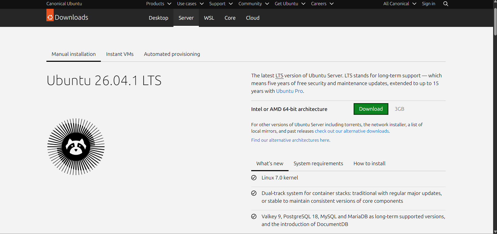
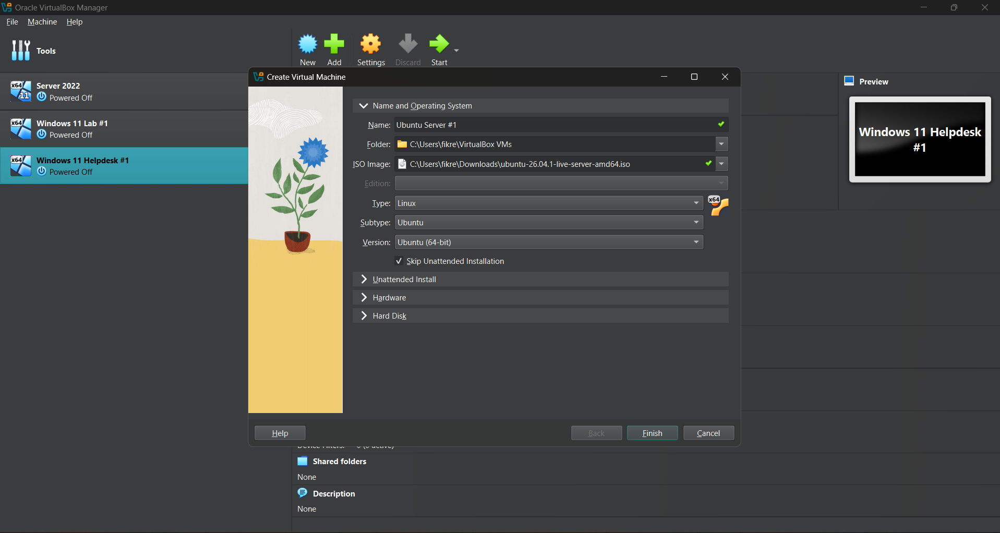
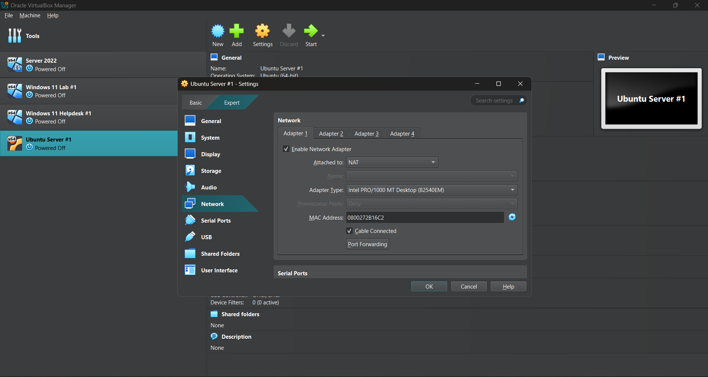
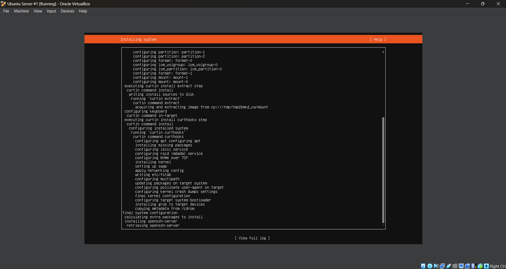
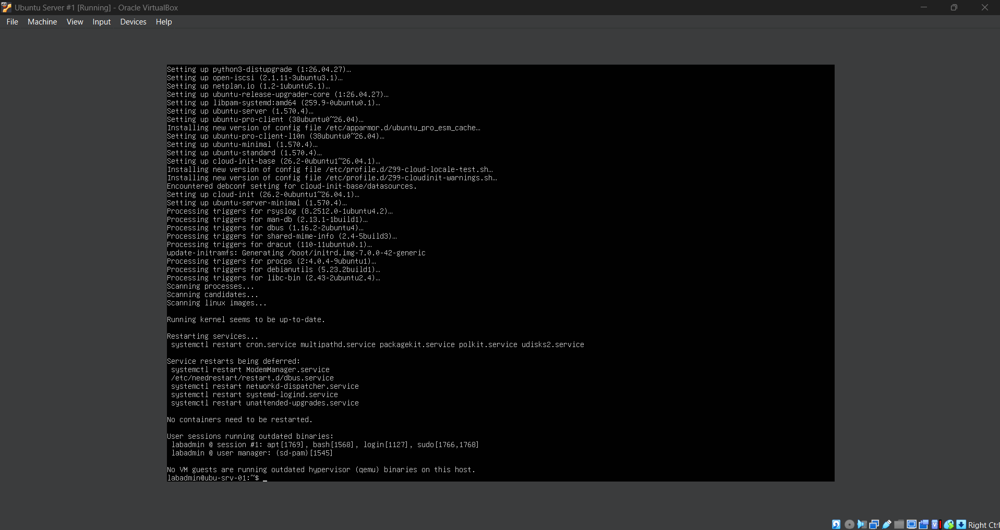
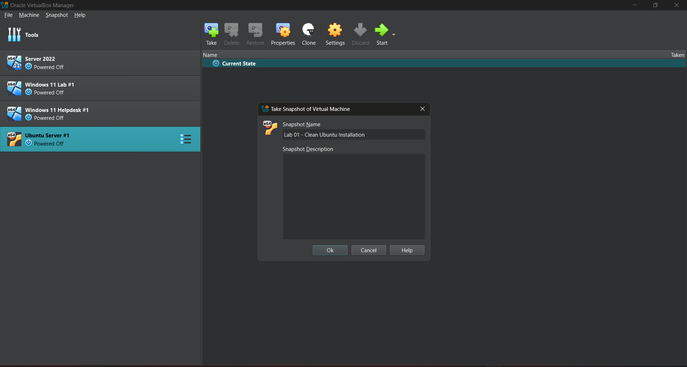

# Lab 01 - Ubuntu Server Installation and Initial Configuration

## **Objective**

Learn how to install and configure Ubuntu Server in Oracle VirtualBox to create a Linux environment for practicing system administration. This lab focuses on creating a virtual machine, configuring network connectivity, installing Ubuntu Server, verifying the operating system, updating system packages, and creating a recovery snapshot for future labs.

## **Environment**

- **Hypervisor / Virtualization:** Oracle VirtualBox
- **Server OS:** Ubuntu Server 26.04.1 LTS
- **Host OS:** Windows
- **Virtual Machine:** Ubuntu Server #1
- **Server Hostname:** `ubu-srv-01`
- **Administrator Account:** `labadmin`
- **Network Configuration:** NAT (Network Address Translation)
- **Remote Administration:** OpenSSH Server

## **Skills Demonstrated**

- Creating and configuring a Linux virtual machine in Oracle VirtualBox
- Installing Ubuntu Server using a bootable ISO image
- Configuring virtual machine networking using NAT
- Understanding basic Linux server installation settings
- Creating a Linux administrator account
- Installing OpenSSH Server for future remote administration
- Using the Linux command-line interface
- Checking system information and network configuration
- Managing software packages using APT
- Creating VirtualBox snapshots for system recovery

## **Steps**

### *Step 1 - Download Ubuntu Server*



I begin by visiting the official Ubuntu website and navigating to the Ubuntu Server download page. I download the **Ubuntu Server 26.04.1 LTS** ISO file for the Intel or AMD 64-bit architecture. I choose Ubuntu Server because I want to learn Linux system administration through the command-line interface rather than relying on a graphical desktop environment. The ISO file contains the installation files needed to deploy Ubuntu Server inside Oracle VirtualBox.

### *Step 2 - Create an Ubuntu Server Virtual Machine*



In Oracle VirtualBox, I select **New** to create a virtual machine for Ubuntu Server. I name the virtual machine `Ubuntu Server #1` and select the Ubuntu Server ISO file downloaded in the previous step.

VirtualBox automatically detects the operating system and configures the following settings:

- **Type:** Linux
- **Subtype:** Ubuntu
- **Version:** Ubuntu (64-bit)

I also check **Skip Unattended Installation** so that I can manually configure Ubuntu Server during the installation process instead of allowing VirtualBox to automatically install the operating system.

I configure the virtual machine with the following resources:

- **Memory:** 4096 MB RAM
- **Processors:** 2 CPUs
- **Virtual Hard Disk:** 25 GB

These resources provide enough capacity for the initial Linux server environment and future administration exercises.

### *Step 3 - Configure Virtual Machine Networking*



Before starting the Ubuntu Server virtual machine, I open **Settings > Network** in Oracle VirtualBox to configure its network connection.

Under **Adapter 1**, I verify that **Enable Network Adapter** is checked and that **Attached to** is set to **NAT (Network Address Translation)**.

NAT allows the Ubuntu Server virtual machine to access external networks through the host computer's network connection. This is important because the server needs internet connectivity to download software packages, install system updates, and communicate with Ubuntu's software repositories.

I also verify that **Cable Connected** is enabled.

For the initial installation, I use NAT networking. In future labs, I plan to configure a Host-Only Adapter to allow communication between the Ubuntu Server and a separate Linux client virtual machine.

### *Step 4 - Install Ubuntu Server*



After configuring the virtual machine, I start it and begin the Ubuntu Server installation process.

During installation, I configure the language, keyboard layout, network settings, storage configuration, and administrator profile.

I create the following administrator account:

- **Server Hostname:** `ubu-srv-01`
- **Username:** `labadmin`
- **Authentication:** Password-based login

I also select **Install OpenSSH Server** so that I can remotely connect to and manage the Ubuntu Server in future labs. I leave SSH identity importing disabled because SSH key authentication will be covered in a later lab.

When prompted to install additional server packages through Featured Server Snaps, I leave the optional packages unchecked because I want to start with a basic Linux server environment.

After confirming the installation settings, Ubuntu begins installing and configuring the operating system.

The installation process includes configuring disk partitions, installing system packages, applying network settings, configuring the Linux kernel, installing the GRUB bootloader, and installing OpenSSH Server.

Once the installation finishes, I remove the installation ISO from the virtual optical drive and reboot the virtual machine.

### *Step 5 - Verify Ubuntu Server Installation*



After rebooting the virtual machine, I log into Ubuntu Server using the `labadmin` account created during installation.

The server successfully loads the Linux command-line interface, confirming that Ubuntu Server was installed and is accessible.

I use the terminal to perform basic system verification and maintenance.

To check the installed Ubuntu version, I can use:

```bash
lsb_release -a
```

This command displays information about the installed Linux distribution, including its version and release name.

To verify the server hostname, I can use:

```bash
hostname
```

This displays the configured hostname, `ubu-srv-01`.

To view the server's network interfaces and assigned IP addresses, I can use:

```bash
ip a
```

The `ip a` command displays network interface information, including IPv4 and IPv6 addresses.

To test network connectivity and DNS resolution, I can use:

```bash
ping -c 4 ubuntu.com
```

The `ping` command sends ICMP requests to a destination, while `-c 4` limits the test to four requests.

I also update the server's software packages using:

```bash
sudo apt update
sudo apt upgrade
```

The `sudo` command allows an authorized user to execute commands with administrative privileges.

The `apt update` command refreshes the package lists from Ubuntu's configured repositories, while `apt upgrade` installs available upgrades for installed software packages.

After completing the package updates, the terminal returns to the `labadmin@ubu-srv-01` command prompt, confirming that the server is accessible and ready for further configuration.

### *Step 6 - Create a Virtual Machine Snapshot*



After completing the initial Ubuntu Server installation and configuration, I shut down the virtual machine and open the **Snapshots** section in Oracle VirtualBox.

I create a snapshot named:

`Lab 01 - Clean Ubuntu Installation`

This snapshot provides a recovery point that can be used to restore the virtual machine to its initial configured state if future changes cause problems.

Snapshots are useful in a home lab because they allow me to experiment with Linux configurations, install software, and troubleshoot issues without needing to reinstall the operating system.

This creates a baseline for future Linux administration labs.

## **Challenges**

No significant installation or configuration issues were documented during this lab.

## **What I Learned**

- How to download and install Ubuntu Server using an ISO image.
- How to create and configure a Linux virtual machine in Oracle VirtualBox.
- How to manually install Ubuntu Server by skipping VirtualBox's unattended installation.
- How NAT networking allows a virtual machine to access external networks through the host computer.
- How to configure a Linux hostname and administrator account during installation.
- How OpenSSH Server provides the foundation for remote Linux administration.
- How Ubuntu Server uses a command-line interface for system administration.
- How to check Linux distribution information using `lsb_release -a`.
- How to view network interfaces and IP addresses using `ip a`.
- How to test network connectivity using `ping`.
- How `sudo` allows authorized users to run administrative commands.
- How to refresh and upgrade installed software packages using APT.
- How VirtualBox snapshots provide recovery points before making system changes.

## **Next Steps**

- Learn basic Linux terminal commands and directory navigation.
- Practice creating, copying, moving, and deleting files and directories.
- Understand the Linux filesystem hierarchy.
- Learn how to view and edit text files from the terminal.
- Begin managing Linux users, groups, and file permissions.
- Configure a separate Linux client virtual machine for future networking and SSH labs.
