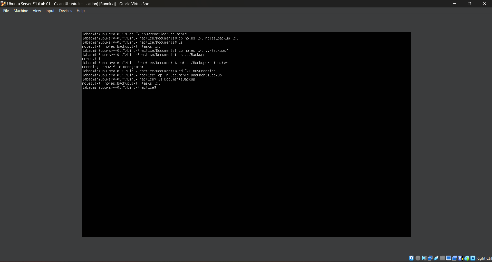
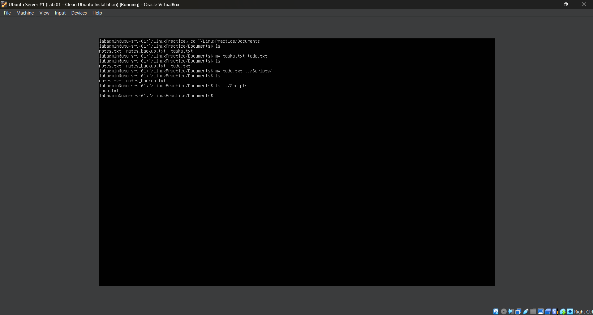
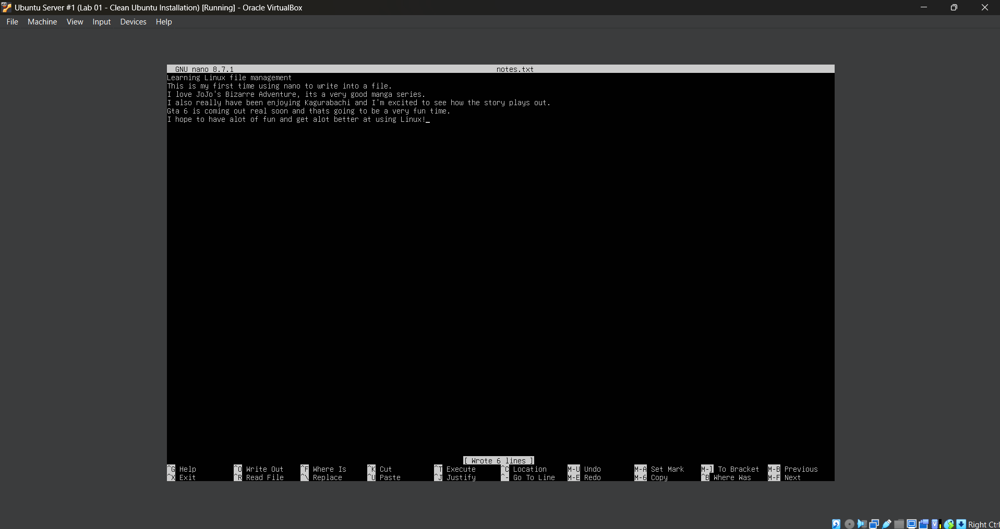
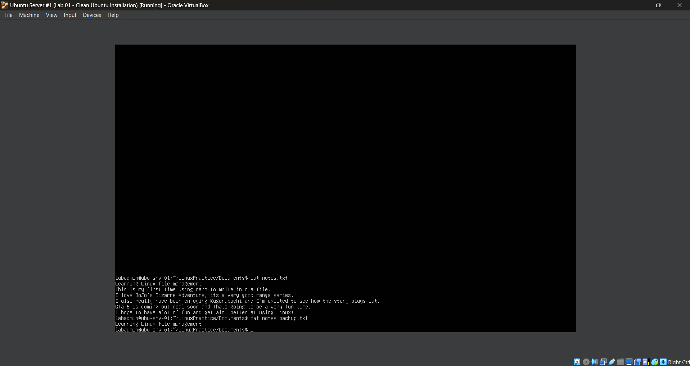
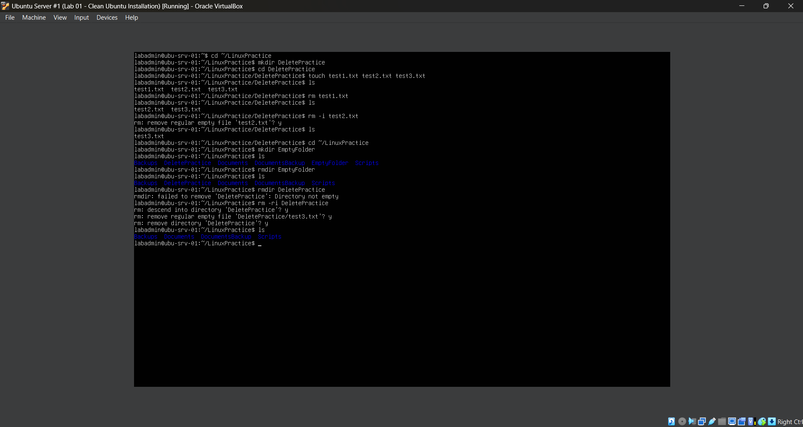
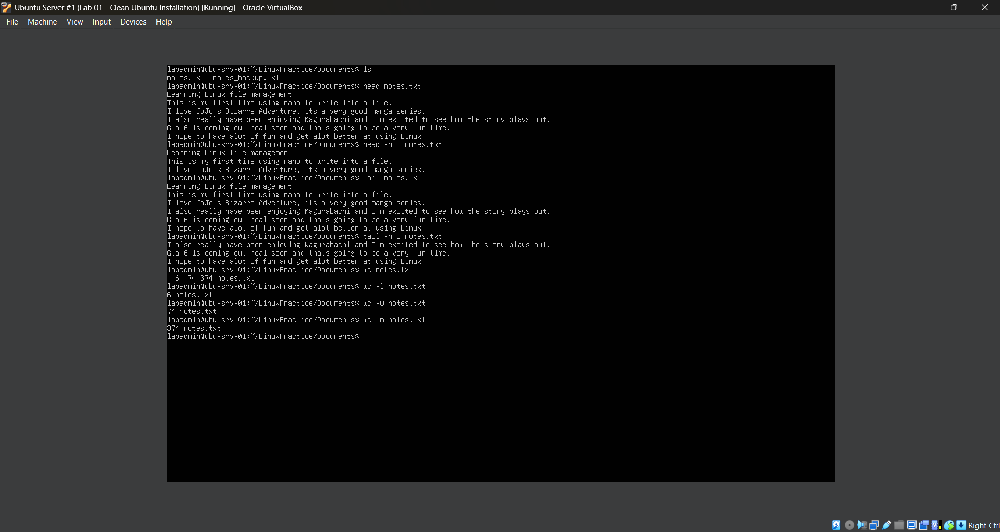
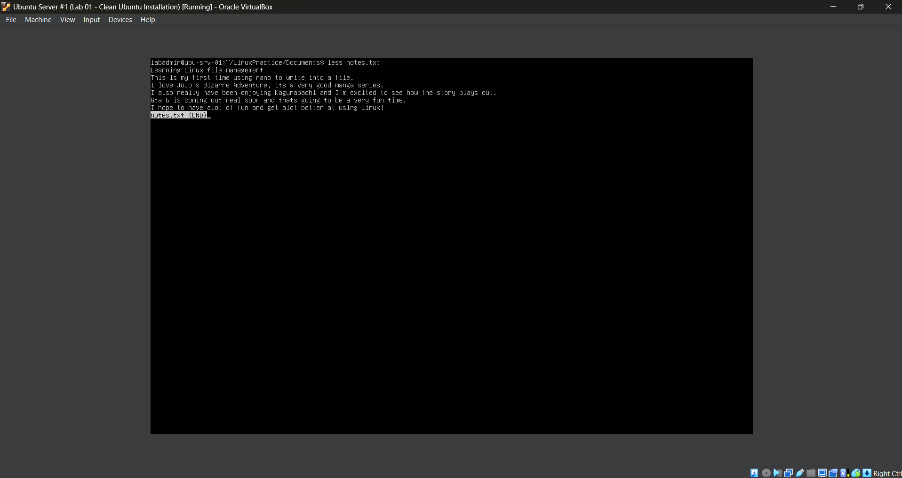
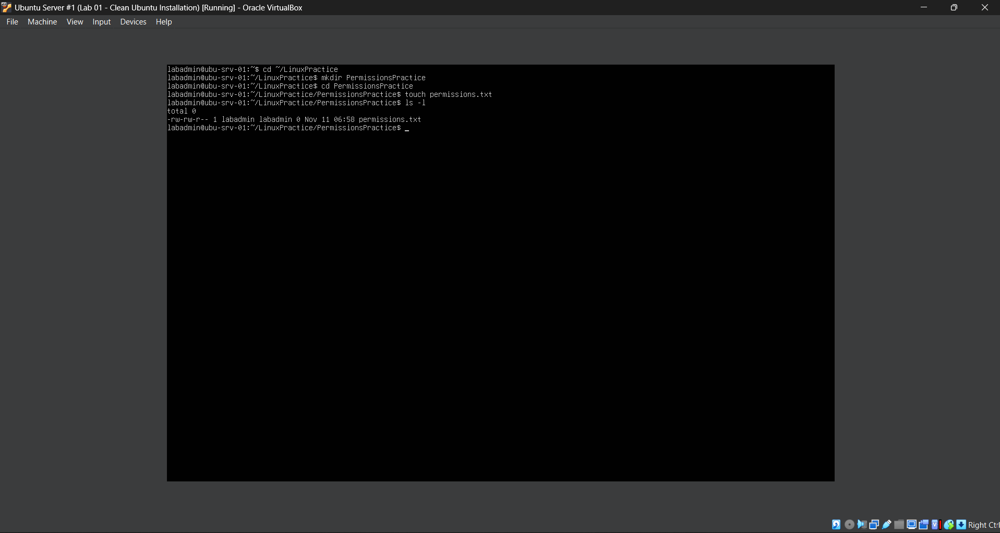
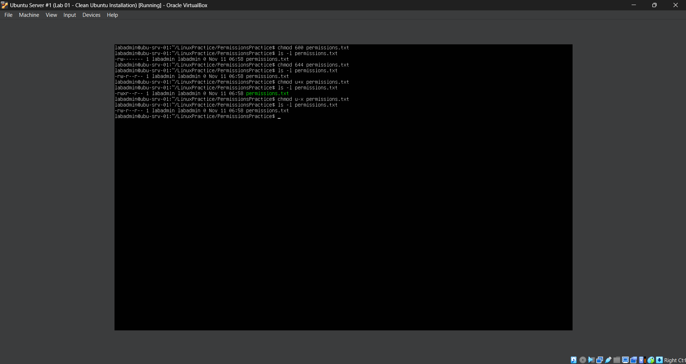
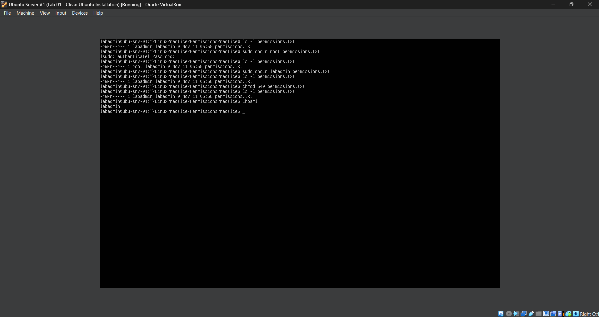

# Lab 2 - Linux Command-Line Fundamentals & File Management

## **Objective**

Learn how to navigate the Linux filesystem and manage files and directories using terminal commands. This lab focuses on understanding the Linux directory structure, creating and organizing files, viewing file contents, copying and moving files, and safely deleting files and directories.

## **Environment**

- **Hypervisor / Virtualization:** Oracle VirtualBox
- **Server OS:** Ubuntu Server 26.04.1 LTS
- **Host OS:** Windows
- **Virtual Machine:** Ubuntu Server #1
- **Server Hostname:** `ubu-srv-01`
- **Administrator Account:** `labadmin`
- **Network Configuration:** NAT (Network Address Translation)
- **Remote Administration:** OpenSSH Server

## **Skills Demonstrated**

- Navigated the Linux filesystem using terminal commands such as `pwd`, `ls`, and `cd`.
- Created and organized directories and files using `mkdir` and `touch`.
- Copied, moved, renamed, and deleted files and directories using `cp`, `mv`, `rm`, and `rmdir`.
- Created backup copies of files and directories using `cp` and the recursive `-r` option.
- Edited and saved text files using the GNU Nano text editor.
- Viewed and analyzed file contents using `cat`, `head`, `tail`, `less`, and `wc`.
- Examined file permissions and ownership using `ls -l`.
- Modified file permissions using `chmod` with numerical and symbolic notation.
- Changed file ownership using `chown` and administrative privileges with `sudo`.
- Verified the current user account using `whoami`.

## **Steps**

### *Step 1 - Explore the Linux Filesystem*


In the Ubuntu Server VM, I begin by exploring the Linux filesystem using basic terminal commands. Since Ubuntu Server does not include a graphical desktop interface by default, I use the command-line interface to navigate between directories and view their contents.

I first use the following command:

```bash
pwd
```

The `pwd` command stands for **Print Working Directory**. It displays the absolute path of the directory I am currently working in.

The command returns:

```text
/home/labadmin
```

This confirms that I am currently in the home directory of the `labadmin` user. In Linux, regular user home directories are typically located under `/home`, with each user having their own directory for personal files and configurations.

Next, I use:

```bash
ls
```

The `ls` command lists the files and directories within the current working directory. In this case, the command does not display any files because there are no visible files or directories in my home directory.

However, Linux also contains hidden files that are not displayed by the standard `ls` command.

To view these files and additional information, I use:

```bash
ls -la
```

This command combines two options:

- `-l` — Displays files and directories in a detailed listing format, including permissions, ownership, file size, and modification date.
- `-a` — Displays all files and directories, including hidden files whose names begin with a period (`.`).

The output displays several hidden files and directories, including:

- `.bashrc` — Contains Bash shell configuration settings and commands that are typically executed when starting an interactive Bash shell.
- `.profile` — Contains user environment settings and commands that may be executed during login.
- `.bash_logout` — Contains commands that Bash may execute when exiting a login shell.
- `.cache` — Stores cached application data.
- `.ssh` — Commonly stores SSH configuration files, authentication keys, and known host information.

The output also includes `.` and `..`, which represent the current directory and its parent directory.

Next, I navigate to another directory using:

```bash
cd /etc
```

The `cd` command stands for **Change Directory** and allows me to move between directories in the Linux filesystem.

The `/etc` directory contains system-wide configuration files used by the operating system, services, and installed applications.

After changing directories, I use:

```bash
pwd
```

The command returns:

```text
/etc
```

This confirms that I successfully navigated from my home directory to `/etc`.

I then use:

```bash
ls
```

This displays the files and directories located inside `/etc`, including configuration files and directories associated with networking, authentication, system services, and other operating system components.

Some examples visible in the output include:

- `hostname` — Stores the system's configured hostname.
- `hosts` — Contains local hostname-to-IP address mappings.
- `ssh` — Contains system-wide SSH configuration files.
- `netplan` — Contains network configuration files used by Netplan.
- `apt` — Contains configuration files and repository settings for Ubuntu's APT package manager.

Finally, I return to my home directory using:

```bash
cd ~
```

The `~` symbol represents the current user's home directory. Using `cd ~` allows me to return to my home directory without typing the complete path.

To verify my location, I use:

```bash
pwd
```

The command returns:

```text
/home/labadmin
```

This confirms that I successfully returned to my home directory.

This step demonstrates how to navigate the Linux filesystem using terminal commands, identify hidden files, inspect directory contents, and understand the difference between user directories and system configuration directories.

### *Step 2 - Create Directories*


In the Ubuntu Server VM, I begin creating a directory structure that I will use to practice Linux file management throughout the remaining steps of this lab.

I first use the following command:

```bash
mkdir LinuxPractice
```

The `mkdir` command stands for **Make Directory** and is used to create new directories in Linux.

In this case, the command creates a directory named `LinuxPractice` inside my current working directory, which is `/home/labadmin`.

Next, I navigate into the newly created directory using:

```bash
cd LinuxPractice
```

The `cd` command stands for **Change Directory** and allows me to navigate between directories in the Linux filesystem.

After running the command, my terminal prompt changes to:

`labadmin@ubu-srv-01:~/LinuxPractice$`

This confirms that I am now working inside the `LinuxPractice` directory. The `~` symbol represents my home directory, so the full path is `/home/labadmin/LinuxPractice`.

Next, I create three additional directories using:

```bash
mkdir Documents Scripts Backups
```

The `mkdir` command can create multiple directories at once by specifying each directory name separated by a space.

This command creates three directories inside `LinuxPractice`:

- `Documents` — A directory for storing and practicing with text files.
- `Scripts` — A directory that can be used to organize scripts and other files.
- `Backups` — A directory for storing copies of files during future file management exercises.

Finally, I verify that the directories were successfully created using:

```bash
ls
```

The `ls` command lists the contents of the current working directory.

The output displays:

```text
Backups  Documents  Scripts
```

This confirms that all three directories were successfully created inside `LinuxPractice`.

The resulting directory structure is:

```text
/home/labadmin/
└── LinuxPractice/
    ├── Backups/
    ├── Documents/
    └── Scripts/
```

This step demonstrates how to create directories using `mkdir`, navigate between directories using `cd`, and verify directory creation using `ls`. It also shows how multiple directories can be created using a single command.


### *Step 3 - Create and View Files*


In the Ubuntu Server VM, I begin practicing how to create and manage files using Linux terminal commands. After creating the `LinuxPractice` directory structure in the previous step, I navigate into the `Documents` directory to begin working with text files.

I first use the following command:

```bash
cd ~/LinuxPractice/Documents
```

The `cd` command allows me to change my current working directory. Instead of navigating through each directory individually, I specify the path to the `Documents` directory.

The `~` symbol represents my home directory, `/home/labadmin`, allowing me to navigate directly to `/home/labadmin/LinuxPractice/Documents`.

Next, I create two empty text files using:

```bash
touch notes.txt tasks.txt
```

The `touch` command is used to update a file's access and modification timestamps. If the specified file does not already exist, `touch` creates a new empty file.

In this case, I use `touch` to create two files:

- `notes.txt` — A text file that I will use to practice writing and reading file contents.
- `tasks.txt` — An additional text file that I will use in future file management exercises.

The `.txt` extension indicates that these files are intended to contain plain text. Unlike Windows, Linux does not require a file extension to identify or work with a file.

I can also create multiple files using a single `touch` command by separating their filenames with spaces.

Next, I write text into `notes.txt` using:

```bash
echo "Learning Linux file management" > notes.txt
```

The `echo` command displays text or variable values in the terminal. However, in this command, I use the output redirection operator (`>`) to send the text into a file instead of displaying it on the screen.

The command consists of three parts:

- `echo` — Produces the text specified after the command.
- `"Learning Linux file management"` — The text that I want to write into the file.
- `> notes.txt` — Redirects the output into the `notes.txt` file.

The `>` operator creates the destination file if it does not exist or **overwrites its existing contents** if it already exists.

This means that running another command using `> notes.txt` would replace the previous text rather than add to it.

To add new text without overwriting the existing contents, I could instead use the append operator (`>>`):

```bash
echo "Practicing Linux commands" >> notes.txt
```

The `>>` operator appends the new text to the end of the file while preserving its existing contents.

After writing text into `notes.txt`, I verify the file's contents using:

```bash
cat notes.txt
```

The `cat` command stands for **Concatenate** and is commonly used to display the contents of text files directly in the terminal.

Although `cat` can also combine multiple files, I use it here to read the contents of a single file.

The command returns:

```text
Learning Linux file management
```

This confirms that the text was successfully written into `notes.txt` using the `echo` command and output redirection.

This step demonstrates how to create empty files using `touch`, write text into files using `echo` and output redirection, and display file contents using `cat`. It also introduces the difference between overwriting file contents with `>` and appending text with `>>`.


### *Step 4 - Copy Files and Directories*



In the Ubuntu Server VM, I begin practicing how to copy files and directories using Linux terminal commands. Copying files is an important system administration task because it allows administrators to create backups, duplicate configuration files, and preserve important data before making changes.

I first navigate to the `Documents` directory using:

```bash
cd ~/LinuxPractice/Documents
```

This places me inside the directory containing the `notes.txt` and `tasks.txt` files created in Step 3.

Next, I create a copy of `notes.txt` using:

```bash
cp notes.txt notes_backup.txt
```

The `cp` command stands for **Copy** and is used to copy files and directories in Linux.

The basic syntax is:

```bash
cp source destination
```

In this case:

- `cp` — Executes the copy operation.
- `notes.txt` — The original file being copied.
- `notes_backup.txt` — The destination filename for the copied file.

Unlike the `mv` command, which moves or renames files, `cp` preserves the original file while creating a separate copy.

I then verify that the copy was created using:

```bash
ls
```

The output displays:

```text
notes.txt  notes_backup.txt  tasks.txt
```

This confirms that the original file and its copy exist within the same directory.

Next, I copy `notes.txt` into the `Backups` directory created in Step 2:

```bash
cp notes.txt ../Backups/
```

This command introduces the use of **relative paths** when copying files between directories.

The command consists of the following components:

- `cp` — Copies the specified file.
- `notes.txt` — The source file located in my current directory.
- `..` — Represents the parent directory of my current working directory.
- `../Backups/` — Specifies the `Backups` directory located one level above `Documents`.

Since I am currently working inside `/home/labadmin/LinuxPractice/Documents`, the `..` notation refers to `/home/labadmin/LinuxPractice`.

Linux then uses the remaining path, `Backups/`, to locate the destination directory.

To verify that the file was copied successfully, I run:

```bash
ls ../Backups
```

The output displays:

```text
notes.txt
```

This confirms that the file was successfully copied into the `Backups` directory.

I also verify that the copied file contains the original text using:

```bash
cat ../Backups/notes.txt
```

The command returns:

```text
Learning Linux file management
```

This confirms that the contents of the original file were preserved during the copying process.

Next, I return to the main `LinuxPractice` directory using:

```bash
cd ~/LinuxPractice
```

I then create a complete copy of the `Documents` directory using:

```bash
cp -r Documents DocumentsBackup
```

This command introduces the **recursive (`-r`) option**.

By default, the `cp` command copies individual files. To copy an entire directory and its contents, I use the `-r` option.

The command consists of:

- `cp` — Executes the copy operation.
- `-r` — Recursively copies the directory and everything inside it, including any subdirectories.
- `Documents` — The source directory being copied.
- `DocumentsBackup` — The destination directory that will contain the copied files.

Because `DocumentsBackup` does not already exist, Linux creates it and copies the contents of `Documents` into it.

Finally, I verify the copied directory using:

```bash
ls DocumentsBackup
```

The output displays:

```text
notes.txt  notes_backup.txt  tasks.txt
```

This confirms that the `Documents` directory and all three files were successfully copied into `DocumentsBackup`.

The resulting directory structure is:

```text
LinuxPractice/
├── Backups/
│   └── notes.txt
├── Documents/
│   ├── notes.txt
│   ├── notes_backup.txt
│   └── tasks.txt
├── DocumentsBackup/
│   ├── notes.txt
│   ├── notes_backup.txt
│   └── tasks.txt
└── Scripts/
```

This step demonstrates how to copy individual files using `cp`, copy files between directories using relative paths, verify copied file contents using `cat`, and recursively copy entire directories using `cp -r`.

These operations are useful in Linux system administration when backing up files, duplicating directories, and preserving configurations before making changes.


### *Step 5 - Move and Rename Files*



In the Ubuntu Server VM, I begin practicing how to move and rename files using Linux terminal commands. Moving and renaming files is an important system administration task because it allows administrators to organize directories, relocate files, and manage system resources without creating unnecessary copies.

I first navigate to the `Documents` directory using:

```bash
cd ~/LinuxPractice/Documents
```

I then use the `ls` command to verify that the files created in the previous steps are still present.

The output displays:

```text
notes.txt  notes_backup.txt  tasks.txt
```

Next, I rename the `tasks.txt` file using:

```bash
mv tasks.txt todo.txt
```

The `mv` command stands for **Move** and is used to move or rename files and directories in Linux.

The basic syntax is:

```bash
mv source destination
```

The command consists of the following components:

- `mv` — Executes the move or rename operation.
- `tasks.txt` — The original filename.
- `todo.txt` — The new filename.

Because both filenames refer to the same directory, the command renames `tasks.txt` to `todo.txt` without moving it to another directory.

Unlike the `cp` command introduced in Step 4, which creates a separate copy of a file, `mv` changes the file's name or location without intentionally creating an additional copy.

To verify that the file was renamed successfully, I run:

```bash
ls
```

The output displays:

```text
notes.txt  notes_backup.txt  todo.txt
```

This confirms that `tasks.txt` has been renamed to `todo.txt`, while the other files remain unchanged.

Next, I move the renamed file from the `Documents` directory into the `Scripts` directory created in Step 2.

I use the following command:

```bash
mv todo.txt ../Scripts/
```

This command uses a relative path to move the file into another directory.

The command consists of:

- `mv` — Moves the specified file.
- `todo.txt` — The source file located in the current directory.
- `..` — Represents the parent directory of the current working directory.
- `../Scripts/` — Specifies the `Scripts` directory located inside the parent directory.

Since I am currently working inside `/home/labadmin/LinuxPractice/Documents`, the `..` notation refers to `/home/labadmin/LinuxPractice`.

Linux then uses the remaining path, `Scripts/`, to locate the destination directory.

After moving the file, I use:

```bash
ls
```

The output displays:

```text
notes.txt  notes_backup.txt
```

This confirms that `todo.txt` is no longer located inside the `Documents` directory.

Finally, I verify that the file was successfully moved into the `Scripts` directory using:

```bash
ls ../Scripts
```

The output displays:

```text
todo.txt
```

This confirms that `todo.txt` was successfully moved from `Documents` into `Scripts`.

The resulting directory structure is:

```text
LinuxPractice/
├── Backups/
│   └── notes.txt
├── Documents/
│   ├── notes.txt
│   └── notes_backup.txt
├── DocumentsBackup/
│   ├── notes.txt
│   ├── notes_backup.txt
│   └── tasks.txt
└── Scripts/
    └── todo.txt
```

The `DocumentsBackup` directory still contains the original `tasks.txt` file because it was copied in Step 4 before the file was renamed and moved.

This step demonstrates how to rename files using `mv`, move files between directories using relative paths, and verify file operations using `ls`.

These skills are useful in Linux system administration when organizing files, relocating scripts, and managing system configurations.


### *Step 6 - Edit Files Using Nano*





In the Ubuntu Server VM, I begin learning how to edit text files directly from the Linux terminal using Nano. Text editors are important in Linux system administration because many system settings, application configurations, and service configurations are stored in text-based files.

For this step, I use the `notes.txt` file created in Step 3 and practice modifying its contents without creating a new file.

I first navigate to the `Documents` directory using:

```bash
cd ~/LinuxPractice/Documents
```

Next, I open the existing text file using:

```bash
nano notes.txt
```

The `nano` command opens **GNU Nano**, a terminal-based text editor that allows users to create, view, and modify text files directly from the command-line interface.

Unlike the `cat` command, which I previously used to display file contents, Nano allows me to interactively edit text using my keyboard.

The command consists of:

- `nano` — Launches the Nano text editor.
- `notes.txt` — Specifies the file I want to open and edit.

Because `notes.txt` already exists, Nano opens the file and displays its current contents.

The file originally contains:

```text
Learning Linux file management
```

I then add several additional lines of text about my interests and experience learning Linux.

The purpose of this exercise is to practice editing an existing file, so the text itself is not important to the functionality being tested.

After entering the additional text, I save my changes using the following keyboard shortcuts:

- **Ctrl + O (Write Out)** — Saves the current file to disk.
- **Enter** — Confirms the filename when saving.
- **Ctrl + X (Exit)** — Closes Nano and returns to the Linux terminal.

In Nano, the `^` symbol displayed beside keyboard shortcuts represents the **Ctrl** key. For example, `^O` means Ctrl + O.

Unlike the `echo` command with the `>` redirection operator, which replaces the contents of a file, Nano allows me to edit specific portions of an existing file while preserving the remaining text.

After saving the file and exiting Nano, I verify that my changes were successfully written using:

```bash
cat notes.txt
```

The `cat` command displays the updated contents of `notes.txt`, including the original line and the additional text entered through Nano.

This confirms that the changes were successfully saved and that the file can be read outside the text editor.

Next, I verify that the backup created in Step 4 still contains the original text using:

```bash
cat notes_backup.txt
```

The command returns:

```text
Learning Linux file management
```

This confirms that `notes_backup.txt` was not affected by the changes made to `notes.txt`.

Because the backup is a separate copy of the original file, modifying `notes.txt` does not automatically update `notes_backup.txt`.

This demonstrates the importance of creating backup copies before modifying files, particularly when working with Linux system configurations.

The resulting file structure remains:

```text
LinuxPractice/
├── Backups/
│   └── notes.txt
├── Documents/
│   ├── notes.txt
│   └── notes_backup.txt
├── DocumentsBackup/
│   ├── notes.txt
│   ├── notes_backup.txt
│   └── tasks.txt
└── Scripts/
    └── todo.txt
```

The `notes.txt` file inside `Documents` now contains the updated text, while the backup copies retain their earlier contents.

This step demonstrates how to open and edit text files using Nano, save changes using keyboard shortcuts, verify file modifications using `cat`, and confirm that backup files remain unchanged.

These skills are useful in Linux system administration when editing configuration files, modifying scripts, documenting system changes, and preserving original files before making modifications.


### *Step 7 - Delete Files and Directories*



In the Ubuntu Server VM, I begin learning how to delete files and directories using Linux terminal commands. File and directory deletion is an important system administration task because administrators frequently need to remove temporary files, clean up unused directories, and manage system storage.

For this step, I create temporary practice files and directories so I can safely practice deletion commands without affecting the files created in previous steps.

I first navigate to the `LinuxPractice` directory using:

```bash
cd ~/LinuxPractice
```

Next, I create a temporary directory named `DeletePractice` and navigate into it:

```bash
mkdir DeletePractice
cd DeletePractice
```

I then create three temporary text files using:

```bash
touch test1.txt test2.txt test3.txt
```

To verify that the files were created successfully, I run:

```bash
ls
```

The output displays:

```text
test1.txt  test2.txt  test3.txt
```

Next, I practice deleting an individual file using:

```bash
rm test1.txt
```

The `rm` command stands for **Remove** and is used to delete files from the Linux filesystem.

The basic syntax is:

```bash
rm filename
```

The command consists of:

- `rm` — Executes the removal operation.
- `test1.txt` — Specifies the file being deleted.

Unlike deleting a file through Windows File Explorer, the `rm` command normally removes the file without sending it to a Recycle Bin.

This means that files removed using `rm` are not easily recoverable, making it important to verify the filename before executing the command.

I then verify the deletion using:

```bash
ls
```

The output displays:

```text
test2.txt  test3.txt
```

This confirms that `test1.txt` was successfully removed while the remaining files were unaffected.

Next, I practice deleting a file with confirmation using:

```bash
rm -i test2.txt
```

This introduces the **interactive (`-i`) option**.

The `-i` option instructs the `rm` command to request confirmation before deleting a file.

The command consists of:

- `rm` — Removes the specified file.
- `-i` — Enables interactive confirmation before deletion.
- `test2.txt` — Specifies the file being removed.

After executing the command, Linux displays a confirmation prompt:

```text
rm: remove regular empty file 'test2.txt'?
```

I enter `y` and press Enter to confirm the deletion.

I then run:

```bash
ls
```

The output displays:

```text
test3.txt
```

This confirms that `test2.txt` was successfully deleted and that only `test3.txt` remains.

Using `rm -i` provides an additional layer of protection by allowing administrators to confirm a deletion before it occurs.

Next, I return to the main `LinuxPractice` directory using:

```bash
cd ~/LinuxPractice
```

I then create an empty directory named `EmptyFolder` using:

```bash
mkdir EmptyFolder
```

After verifying that the directory exists using `ls`, I remove it using:

```bash
rmdir EmptyFolder
```

The `rmdir` command stands for **Remove Directory** and is used to remove empty directories from the Linux filesystem.

The basic syntax is:

```bash
rmdir directory_name
```

The command consists of:

- `rmdir` — Removes an empty directory.
- `EmptyFolder` — Specifies the directory being removed.

Unlike `rm`, which can remove individual files, `rmdir` is specifically designed to remove directories that contain no files or subdirectories.

I verify the deletion using:

```bash
ls
```

The output confirms that `EmptyFolder` no longer exists.

Next, I test what happens when attempting to remove a directory that still contains files.

Since `DeletePractice` still contains `test3.txt`, I run:

```bash
rmdir DeletePractice
```

Linux returns the following error:

```text
rmdir: failed to remove 'DeletePractice': Directory not empty
```

This error occurs because `rmdir` only removes empty directories.

Since `DeletePractice` still contains a file, Linux prevents the directory from being removed using this command.

This demonstrates an important distinction between removing empty directories and removing directories containing files.

Finally, I practice recursively deleting a directory and its contents using:

```bash
rm -ri DeletePractice
```

This command combines the **recursive (`-r`)** and **interactive (`-i`)** options.

The command consists of:

- `rm` — Executes the removal operation.
- `-r` — Recursively removes a directory and its contents, including files and subdirectories.
- `-i` — Requests confirmation before each removal.
- `DeletePractice` — Specifies the directory being removed.

The `-r` option was previously introduced in Step 4 when copying directories using `cp -r`. In this step, I learn that the same option can be used with `rm` to recursively remove directories.

After executing the command, Linux requests confirmation before descending into the directory, removing `test3.txt`, and removing the directory itself.

I enter `y` and press Enter for each confirmation prompt.

Once the operation is complete, I verify the deletion using:

```bash
ls
```

The output displays:

```text
Backups  Documents  DocumentsBackup  Scripts
```

This confirms that both `DeletePractice` and `EmptyFolder` were successfully removed while the original practice directories remain intact.

The resulting directory structure is:

```text
LinuxPractice/
├── Backups/
│   └── notes.txt
├── Documents/
│   ├── notes.txt
│   └── notes_backup.txt
├── DocumentsBackup/
│   ├── notes.txt
│   ├── notes_backup.txt
│   └── tasks.txt
└── Scripts/
    └── todo.txt
```

This step demonstrates how to delete individual files using `rm`, request confirmation using `rm -i`, remove empty directories using `rmdir`, and recursively delete directories using `rm -ri`.

I also learned that `rmdir` cannot remove non-empty directories and that Linux deletion commands should be used carefully because removed files may not be recoverable.

These skills are useful in Linux system administration when cleaning up temporary files, removing unused directories, managing storage, and safely maintaining the filesystem.


### *Step 8 - Viewing and Analyzing File Contents*





In the Ubuntu Server VM, I begin learning how to view and analyze the contents of text files using Linux terminal commands. These commands are important in Linux system administration because administrators frequently need to inspect configuration files, examine system logs, and troubleshoot issues without modifying the original files.

For this step, I use the `notes.txt` file that I previously created in Step 3 and modified using Nano in Step 6.

I first navigate to the `Documents` directory using:

```bash
cd ~/LinuxPractice/Documents
```

I then use the `ls` command to verify that `notes.txt` and `notes_backup.txt` are still present.

Next, I practice displaying the beginning of a text file using:

```bash
head notes.txt
```

The `head` command displays the beginning of a file. By default, it displays the first 10 lines.

The basic syntax is:

```bash
head filename
```

The command consists of:

- `head` — Displays the beginning of a file.
- `notes.txt` — Specifies the file being examined.

Since my `notes.txt` file contains fewer than 10 lines, the command displays the entire file.

Next, I practice limiting the number of lines displayed using:

```bash
head -n 3 notes.txt
```

This introduces the **number of lines (`-n`) option**.

The command consists of:

- `head` — Displays the beginning of a file.
- `-n` — Specifies how many lines should be displayed.
- `3` — Tells Linux to display the first three lines.
- `notes.txt` — Specifies the file being examined.

The output displays:

```text
Learning Linux file management
This is my first time using nano to write into a file.
I love JoJo's Bizarre Adventure, its a very good manga series.
```

This confirms that the `head -n 3` command successfully displays only the first three lines of the file.

This command is useful when administrators need to quickly examine the beginning of large configuration files or logs without displaying their entire contents.

Next, I practice displaying the end of a text file using:

```bash
tail notes.txt
```

The `tail` command displays the end of a file. By default, it displays the last 10 lines.

The basic syntax is:

```bash
tail filename
```

The command consists of:

- `tail` — Displays the end of a file.
- `notes.txt` — Specifies the file being examined.

Since my file contains fewer than 10 lines, the entire file is displayed.

Next, I limit the output to the last three lines using:

```bash
tail -n 3 notes.txt
```

The command consists of:

- `tail` — Displays the end of a file.
- `-n 3` — Specifies that only the last three lines should be displayed.
- `notes.txt` — Specifies the file being examined.

The output displays the final three lines of my file, confirming that the command works as intended.

The `tail` command is particularly useful in Linux system administration when examining recent log entries. Administrators can use it to quickly view the latest messages recorded by a system or application.

Another useful option is `tail -f`, which continuously monitors a file and displays new data as it is appended. Although I did not practice this option during this step, it is commonly used when monitoring system logs in real time.

Next, I practice viewing a text file using:

```bash
less notes.txt
```

The `less` command opens a file in a terminal-based viewer, allowing users to navigate through its contents without modifying the file.

Unlike Nano, which I used in Step 6 to edit text files, `less` is primarily designed for viewing and navigating file contents.

The basic syntax is:

```bash
less filename
```

The command consists of:

- `less` — Opens the terminal-based file viewer.
- `notes.txt` — Specifies the file being viewed.

After executing the command, the contents of `notes.txt` appear inside the `less` interface.

Because my file is relatively short, the entire contents fit on one screen.

The `less` command also supports several keyboard shortcuts:

- **Up / Down Arrow Keys** — Navigate through the file one line at a time.
- **Space** — Move forward one screen.
- **b** — Move backward one screen.
- **g** — Jump to the beginning of the file.
- **G** — Jump to the end of the file.
- **/word** — Search for specific text within the file.
- **q** — Exit the viewer and return to the terminal.

This command is useful when administrators need to examine large log files, configuration files, or other text-based information without opening a text editor.

After viewing the file, I exit the `less` interface and return to the terminal.

Next, I practice analyzing the contents of a file using:

```bash
wc notes.txt
```

The `wc` command stands for **Word Count** and is used to count lines, words, and bytes within a file.

The basic syntax is:

```bash
wc filename
```

The command consists of:

- `wc` — Counts lines, words, and bytes.
- `notes.txt` — Specifies the file being analyzed.

The output displays:

```text
6 74 374 notes.txt
```

These values represent:

- `6` — Number of lines in the file, counted by newline characters.
- `74` — Number of words in the file.
- `374` — Number of bytes in the file.
- `notes.txt` — Name of the file being analyzed.

Next, I practice displaying only the number of lines using:

```bash
wc -l notes.txt
```

The `-l` option counts newline characters within the file.

The output displays:

```text
6 notes.txt
```

This confirms that my file contains six newline-terminated lines.

Next, I practice counting only the words using:

```bash
wc -w notes.txt
```

The `-w` option tells Linux to count the number of words within the file.

The output displays:

```text
74 notes.txt
```

This confirms that my file contains 74 words.

Finally, I practice counting the number of characters using:

```bash
wc -m notes.txt
```

The `-m` option counts the number of characters within the file.

The output displays:

```text
374 notes.txt
```

This confirms that my file contains 374 characters.

Although the byte count and character count are identical in this example, they are not always the same. Certain characters, including some international characters and emojis, can require multiple bytes to represent a single character.

This step demonstrates how to display the beginning of files using `head`, display the end of files using `tail`, navigate through files using `less`, and analyze file contents using `wc`.

I also learned how command options such as `-n`, `-l`, `-w`, and `-m` can modify the behavior of these commands to display specific information.

These skills are useful in Linux system administration when inspecting system logs, reviewing configuration files, troubleshooting errors, and analyzing text-based information without modifying the original files.


### *Step 9 - Linux File Permissions and Ownership*







In the Ubuntu Server VM, I begin learning how Linux manages file permissions and ownership. File permissions are important in Linux system administration because they determine which users can read, modify, or execute files.

For this step, I create a separate practice directory to experiment with permissions without affecting the files created in previous steps.

I first navigate to my `LinuxPractice` directory and create a new folder called `PermissionsPractice` using:

```bash
cd ~/LinuxPractice
mkdir PermissionsPractice
cd PermissionsPractice
```

Next, I create an empty text file using:

```bash
touch permissions.txt
```

I then examine the file's permissions and ownership using:

```bash
ls -l
```

The `-l` option displays a detailed listing of files, including their permissions, ownership, size, and modification date.

The output shows:

```text
-rw-rw-r-- 1 labadmin labadmin 0 Nov 11 06:58 permissions.txt
```

The first section, `-rw-rw-r--`, represents the file's permissions.

Linux permissions are divided into three categories:

- **Owner (User)** — The user who owns the file.
- **Group** — Users who belong to the file's assigned group.
- **Others** — All other users.

Each category can have three types of permissions:

- `r` — Read permission.
- `w` — Write permission.
- `x` — Execute permission.

The initial permissions indicate that the owner and group can read and write the file, while other users can only read it.

Next, I practice changing file permissions using:

```bash
chmod 600 permissions.txt
ls -l permissions.txt
```

The `chmod` command stands for **Change Mode** and is used to modify file and directory permissions.

Linux can represent permissions using numerical values:

- `4` — Read permission.
- `2` — Write permission.
- `1` — Execute permission.
- `0` — No permissions.

These values can be added together to create different permission combinations.

For example, `600` means:

- `6` — Owner has read and write permissions (4 + 2).
- `0` — Group has no permissions.
- `0` — Others have no permissions.

The output changes to:

```text
-rw-------
```

This confirms that only the file owner has permission to read and modify the file.

Next, I change the permissions again using:

```bash
chmod 644 permissions.txt
ls -l permissions.txt
```

The `644` permission setting means:

- `6` — Owner can read and write.
- `4` — Group can read.
- `4` — Others can read.

The output displays:

```text
-rw-r--r--
```

This confirms that the owner has read and write permissions, while the group and others have read-only access.

Next, I practice changing permissions using symbolic notation instead of numerical values.

I execute:

```bash
chmod u+x permissions.txt
ls -l permissions.txt
```

The command consists of:

- `chmod` — Changes file permissions.
- `u` — Represents the file owner.
- `+` — Adds a permission.
- `x` — Represents execute permission.
- `permissions.txt` — Specifies the file being modified.

The output displays:

```text
-rwxr--r--
```

This confirms that execute permission has been added for the file owner.

I also notice that the filename changes to green in the terminal, indicating that the file now has executable permissions.

Next, I remove the execute permission using:

```bash
chmod u-x permissions.txt
ls -l permissions.txt
```

The `-` symbol removes the specified permission.

The output returns to:

```text
-rw-r--r--
```

This confirms that execute permission was successfully removed.

Next, I begin learning about Linux file ownership.

I first check the file's current ownership using:

```bash
ls -l permissions.txt
```

The output shows that the file belongs to the user `labadmin` and the group `labadmin`.

I then change the file's owner to `root` using:

```bash
sudo chown root permissions.txt
ls -l permissions.txt
```

This introduces two important Linux commands:

- `sudo` — Executes a command with elevated privileges, typically as the root user.
- `chown` — Stands for **Change Owner** and is used to change the ownership of files and directories.

The `root` account is the superuser account in Linux and has administrative privileges.

After executing the command, I am prompted to enter my password to authorize the operation.

The output shows:

```text
-rw-r--r-- 1 root labadmin 0 Nov 11 06:58 permissions.txt
```

This confirms that the file's owner has changed from `labadmin` to `root`, while the assigned group remains `labadmin`.

Next, I restore ownership to my original user account using:

```bash
sudo chown labadmin permissions.txt
ls -l permissions.txt
```

The output confirms that `labadmin` is once again the owner of the file.

Next, I perform a final permissions test using:

```bash
chmod 640 permissions.txt
ls -l permissions.txt
```

The `640` permission setting means:

- `6` — Owner has read and write permissions.
- `4` — Group has read-only permission.
- `0` — Others have no permissions.

The output displays:

```text
-rw-r-----
```

This confirms that the file permissions have been successfully updated.

Finally, I verify which user account I am currently logged into using:

```bash
whoami
```

The `whoami` command displays the username associated with the current effective user identity.

The output displays:

```text
labadmin
```

This confirms that I am operating under my regular `labadmin` account.

This step demonstrates how to view and modify Linux file permissions using `ls -l` and `chmod`, change file ownership using `chown`, and execute administrative commands using `sudo`.

These skills are important in Linux system administration because correctly configured permissions and ownership help protect sensitive files, restrict unauthorized access, and ensure that users and applications have the appropriate level of access.

## **Challenges**

- One of the initial challenges was becoming familiar with navigating the Linux filesystem through the command line rather than using a graphical file explorer. I had to understand how directories are organized and how relative and absolute paths work. Through practice, I became more comfortable using `cd` to navigate between directories, `pwd` to verify my current location, and `~` to reference my home directory.
- Another learning challenge was understanding how Linux represents file permissions using numerical values and symbolic notation. Initially, I was unfamiliar with how values such as `600`, `644`, and `640` determine access for file owners, groups, and other users. By experimenting with `chmod` and verifying the results using `ls -l`, I gained a better understanding of how read, write, and execute permissions are assigned and modified.

## **What I Learned**

Throughout this lab, I gained a better understanding of navigating the Linux filesystem and managing files through the command line. I learned how to create, organize, copy, move, rename, and delete files and directories without relying on a graphical interface. I also became more comfortable using commands to inspect file contents, edit text files with Nano, and create backups. One of my biggest takeaways was understanding how Linux manages file permissions and ownership. By practicing with `chmod` and `chown`, I learned how read, write, and execute permissions control access for file owners, groups, and other users. I also gained experience using `sudo` to perform administrative tasks and learned the importance of assigning appropriate permissions to protect files from unauthorized access.

## **Next Steps**

In Lab 03, I plan to focus on Linux user and group management to gain a better understanding of how administrators manage accounts and control access to system resources. This will include creating user accounts with `adduser`, managing passwords with `passwd`, viewing account information with `id`, and creating and managing groups using `groupadd` and `usermod`. I also plan to practice switching between user accounts using `su`, managing administrative privileges with `sudo`, and disabling or removing accounts when they are no longer needed. These exercises will help me understand how Linux handles user administration and access control, building on the file permissions and ownership concepts introduced in this lab.
