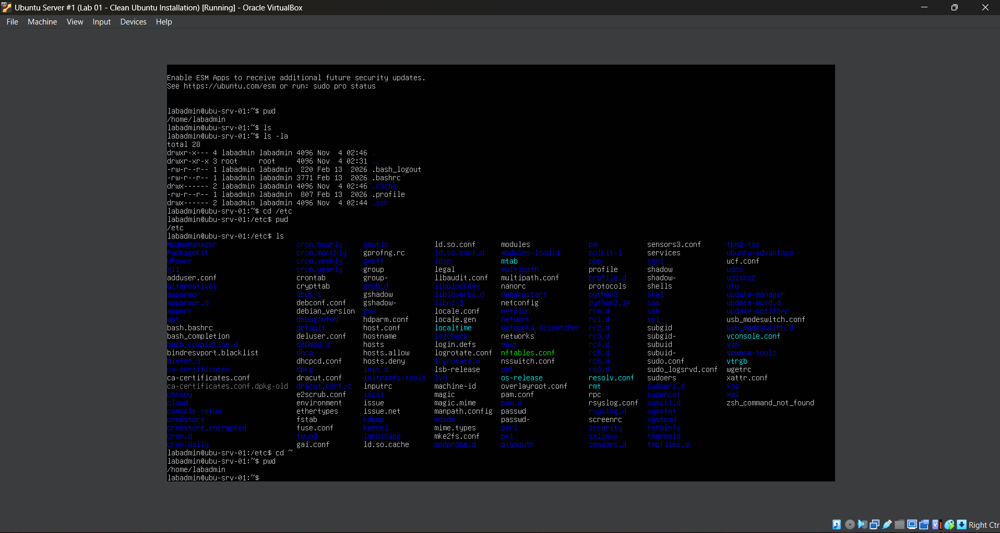
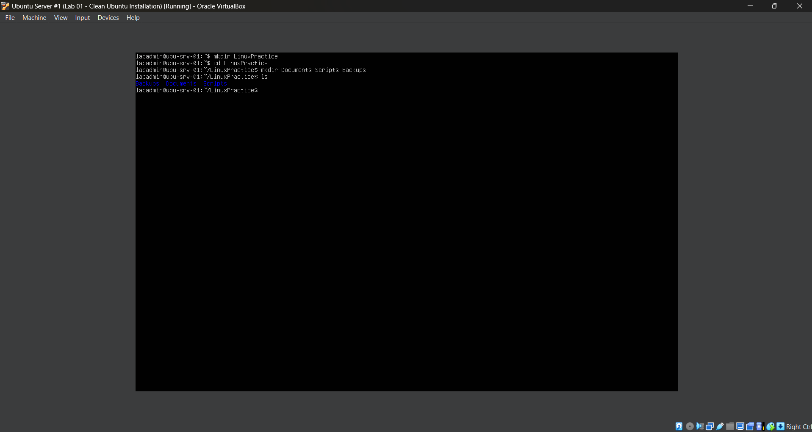
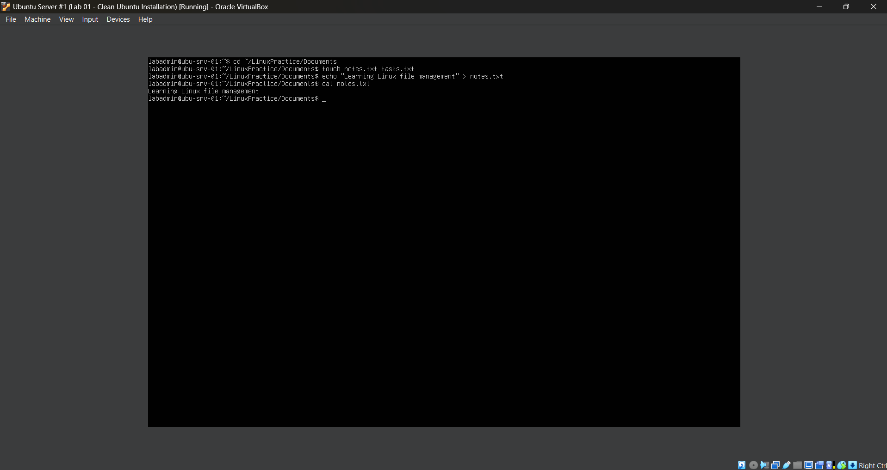

# Lab 2 - Linux Command-Line Fundamentals & File Management

## **Objective**

Learn how to navigate the Linux filesystem and manage files and directories using terminal commands. This lab focuses on understanding the Linux directory structure, creating and organizing files, viewing file contents, copying and moving files, and safely deleting files and directories.

## **Environment**

- **Hypervisor / Virtualization:** Oracle VirtualBox
- **Server OS:** Ubuntu Server 26.04.1 LTS
- **Host OS:** Windows
- **Virtual Machine:** Ubuntu Server #1
- **Server Hostname:** `ubu-srv-01`
- **Administrator Account:** `labadmin`
- **Network Configuration:** NAT (Network Address Translation)
- **Remote Administration:** OpenSSH Server

## **Skills Demonstrated**

## **Steps**

### *Step 1 - Explore the Linux Filesystem*



In the Ubuntu Server VM, I begin by exploring the Linux filesystem using basic terminal commands. Since Ubuntu Server does not include a graphical desktop interface by default, I use the command-line interface to navigate between directories and view their contents.

I first use the following command:

```bash
pwd
```

The `pwd` command stands for **Print Working Directory**. It displays the absolute path of the directory I am currently working in.

The command returns:

```text
/home/labadmin
```

This confirms that I am currently in the home directory of the `labadmin` user. In Linux, regular user home directories are typically located under `/home`, with each user having their own directory for personal files and configurations.

Next, I use:

```bash
ls
```

The `ls` command lists the files and directories within the current working directory. In this case, the command does not display any files because there are no visible files or directories in my home directory.

However, Linux also contains hidden files that are not displayed by the standard `ls` command.

To view these files and additional information, I use:

```bash
ls -la
```

This command combines two options:

- `-l` — Displays files and directories in a detailed listing format, including permissions, ownership, file size, and modification date.
- `-a` — Displays all files and directories, including hidden files whose names begin with a period (`.`).

The output displays several hidden files and directories, including:

- `.bashrc` — Contains Bash shell configuration settings and commands that are typically executed when starting an interactive Bash shell.
- `.profile` — Contains user environment settings and commands that may be executed during login.
- `.bash_logout` — Contains commands that Bash may execute when exiting a login shell.
- `.cache` — Stores cached application data.
- `.ssh` — Commonly stores SSH configuration files, authentication keys, and known host information.

The output also includes `.` and `..`, which represent the current directory and its parent directory.

Next, I navigate to another directory using:

```bash
cd /etc
```

The `cd` command stands for **Change Directory** and allows me to move between directories in the Linux filesystem.

The `/etc` directory contains system-wide configuration files used by the operating system, services, and installed applications.

After changing directories, I use:

```bash
pwd
```

The command returns:

```text
/etc
```

This confirms that I successfully navigated from my home directory to `/etc`.

I then use:

```bash
ls
```

This displays the files and directories located inside `/etc`, including configuration files and directories associated with networking, authentication, system services, and other operating system components.

Some examples visible in the output include:

- `hostname` — Stores the system's configured hostname.
- `hosts` — Contains local hostname-to-IP address mappings.
- `ssh` — Contains system-wide SSH configuration files.
- `netplan` — Contains network configuration files used by Netplan.
- `apt` — Contains configuration files and repository settings for Ubuntu's APT package manager.

Finally, I return to my home directory using:

```bash
cd ~
```

The `~` symbol represents the current user's home directory. Using `cd ~` allows me to return to my home directory without typing the complete path.

To verify my location, I use:

```bash
pwd
```

The command returns:

```text
/home/labadmin
```

This confirms that I successfully returned to my home directory.

This step demonstrates how to navigate the Linux filesystem using terminal commands, identify hidden files, inspect directory contents, and understand the difference between user directories and system configuration directories.

### *Step 2 - Create Directories*



In the Ubuntu Server VM, I begin creating a directory structure that I will use to practice Linux file management throughout the remaining steps of this lab.

I first use the following command:

```bash
mkdir LinuxPractice
```

The `mkdir` command stands for **Make Directory** and is used to create new directories in Linux.

In this case, the command creates a directory named `LinuxPractice` inside my current working directory, which is `/home/labadmin`.

Next, I navigate into the newly created directory using:

```bash
cd LinuxPractice
```

The `cd` command stands for **Change Directory** and allows me to navigate between directories in the Linux filesystem.

After running the command, my terminal prompt changes to:

`labadmin@ubu-srv-01:~/LinuxPractice$`

This confirms that I am now working inside the `LinuxPractice` directory. The `~` symbol represents my home directory, so the full path is `/home/labadmin/LinuxPractice`.

Next, I create three additional directories using:

```bash
mkdir Documents Scripts Backups
```

The `mkdir` command can create multiple directories at once by specifying each directory name separated by a space.

This command creates three directories inside `LinuxPractice`:

- `Documents` — A directory for storing and practicing with text files.
- `Scripts` — A directory that can be used to organize scripts and other files.
- `Backups` — A directory for storing copies of files during future file management exercises.

Finally, I verify that the directories were successfully created using:

```bash
ls
```

The `ls` command lists the contents of the current working directory.

The output displays:

```text
Backups  Documents  Scripts
```

This confirms that all three directories were successfully created inside `LinuxPractice`.

The resulting directory structure is:

```text
/home/labadmin/
└── LinuxPractice/
    ├── Backups/
    ├── Documents/
    └── Scripts/
```

This step demonstrates how to create directories using `mkdir`, navigate between directories using `cd`, and verify directory creation using `ls`. It also shows how multiple directories can be created using a single command.


### *Step 3 - Create and View Files*



In the Ubuntu Server VM, I begin practicing how to create and manage files using Linux terminal commands. After creating the `LinuxPractice` directory structure in the previous step, I navigate into the `Documents` directory to begin working with text files.

I first use the following command:

```bash
cd ~/LinuxPractice/Documents
```

The `cd` command allows me to change my current working directory. Instead of navigating through each directory individually, I specify the path to the `Documents` directory.

The `~` symbol represents my home directory, `/home/labadmin`, allowing me to navigate directly to `/home/labadmin/LinuxPractice/Documents`.

Next, I create two empty text files using:

```bash
touch notes.txt tasks.txt
```

The `touch` command is used to update a file's access and modification timestamps. If the specified file does not already exist, `touch` creates a new empty file.

In this case, I use `touch` to create two files:

- `notes.txt` — A text file that I will use to practice writing and reading file contents.
- `tasks.txt` — An additional text file that I will use in future file management exercises.

The `.txt` extension indicates that these files are intended to contain plain text. Unlike Windows, Linux does not require a file extension to identify or work with a file.

I can also create multiple files using a single `touch` command by separating their filenames with spaces.

Next, I write text into `notes.txt` using:

```bash
echo "Learning Linux file management" > notes.txt
```

The `echo` command displays text or variable values in the terminal. However, in this command, I use the output redirection operator (`>`) to send the text into a file instead of displaying it on the screen.

The command consists of three parts:

- `echo` — Produces the text specified after the command.
- `"Learning Linux file management"` — The text that I want to write into the file.
- `> notes.txt` — Redirects the output into the `notes.txt` file.

The `>` operator creates the destination file if it does not exist or **overwrites its existing contents** if it already exists.

This means that running another command using `> notes.txt` would replace the previous text rather than add to it.

To add new text without overwriting the existing contents, I could instead use the append operator (`>>`):

```bash
echo "Practicing Linux commands" >> notes.txt
```

The `>>` operator appends the new text to the end of the file while preserving its existing contents.

After writing text into `notes.txt`, I verify the file's contents using:

```bash
cat notes.txt
```

The `cat` command stands for **Concatenate** and is commonly used to display the contents of text files directly in the terminal.

Although `cat` can also combine multiple files, I use it here to read the contents of a single file.

The command returns:

```text
Learning Linux file management
```

This confirms that the text was successfully written into `notes.txt` using the `echo` command and output redirection.

This step demonstrates how to create empty files using `touch`, write text into files using `echo` and output redirection, and display file contents using `cat`. It also introduces the difference between overwriting file contents with `>` and appending text with `>>`.

## **Challenges**

## **What I Learned**

## **Next Steps**
