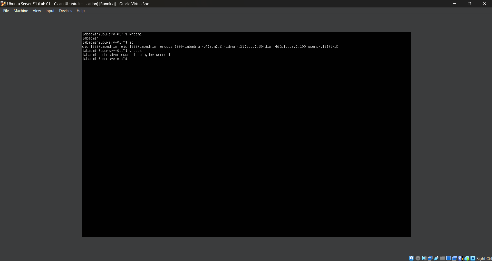
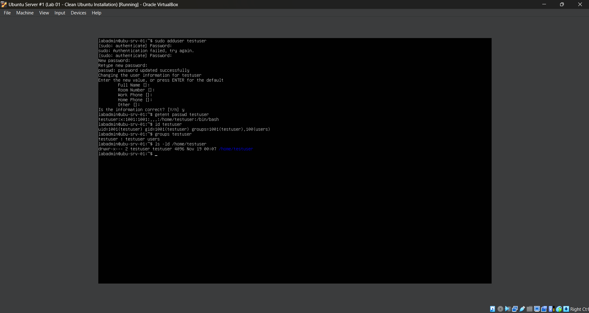
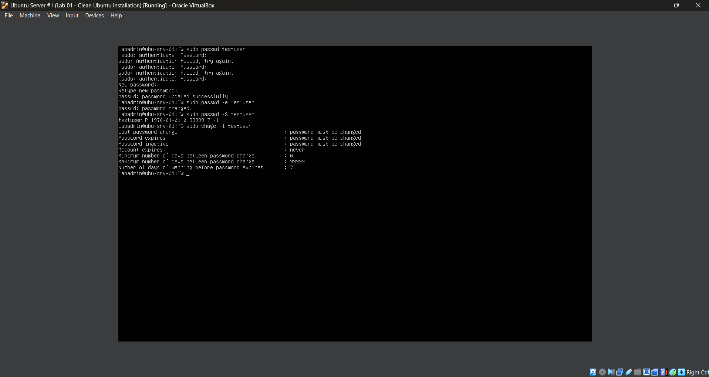
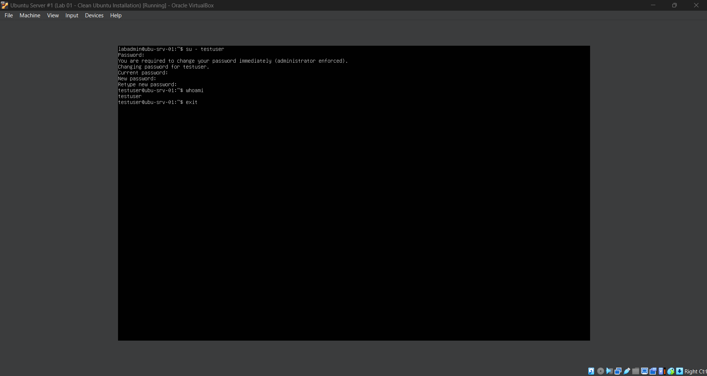
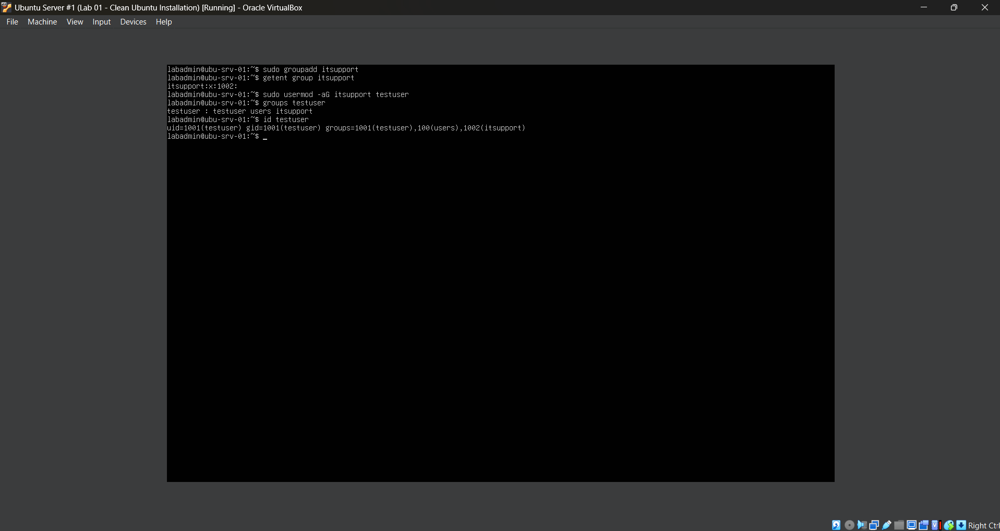
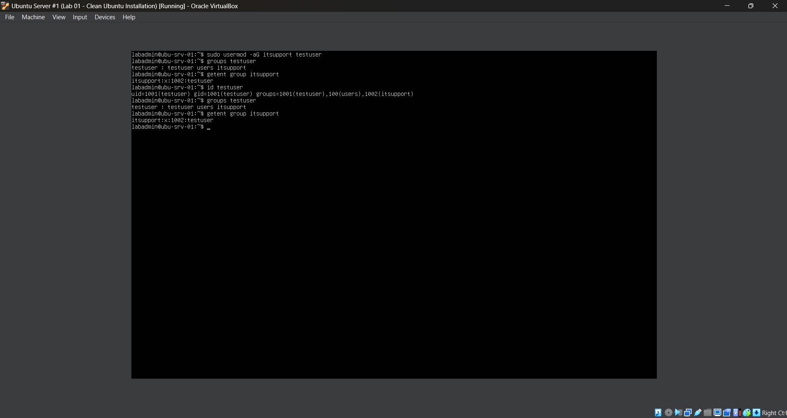
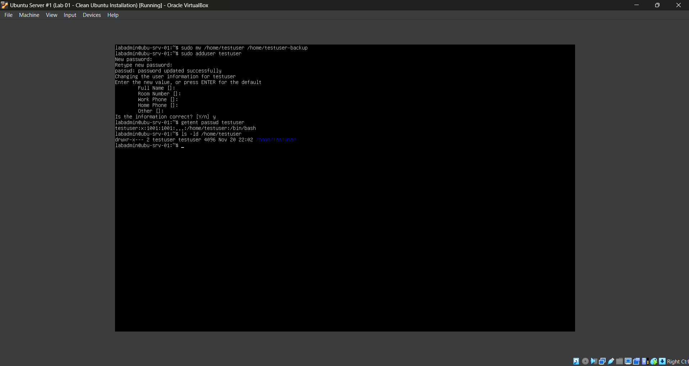
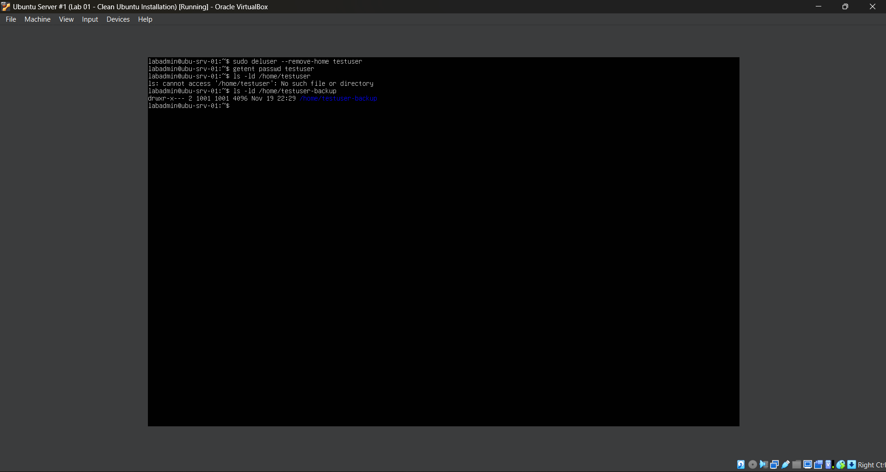

# Lab 3 - Linux User and Group Management

## **Objective**

## **Environment**

## **Skills Demonstrated**

## **Steps**


### Step 1 – Examining Existing Users and Groups




I began by examining the existing user account and group memberships on my Ubuntu Server. Before creating or managing additional users, I wanted to understand how Linux identifies users, assigns group memberships, and stores account information.

First, I ran the following commands to identify my current user and examine its group memberships:

```bash
whoami
id
groups
```

- **`whoami`** – Displays the username of the account currently logged into the system. In my case, the command returned `labadmin`.
- **`id`** – Displays information about the current user, including their User ID (UID), primary Group ID (GID), and supplementary group memberships.
- **`groups`** – Lists the groups that the current user belongs to.

The `id` command showed that my `labadmin` account has a UID of `1000` and a primary GID of `1000`. It also showed several supplementary groups, including `sudo`, which allows authorized users to perform administrative tasks.

Next, I used the following commands to examine how Linux stores user and group information:

```bash
getent passwd labadmin
getent group sudo
```

- **`getent`** – Retrieves entries from system databases, including user accounts and groups.
- **`getent passwd labadmin`** – Displays account information for `labadmin`, including its UID, GID, home directory, and default shell.
- **`getent group sudo`** – Displays information about the `sudo` group, including its GID and listed members.

The `getent passwd labadmin` command returned information showing that my account uses `/home/labadmin` as its home directory and `/bin/bash` as its default shell.

The `getent group sudo` command confirmed that `labadmin` is a member of the `sudo` group, which provides administrative privileges through the `sudo` command.

This step helped me understand how Linux identifies user accounts and organizes permissions through group memberships. It also introduced me to the difference between a user's primary group and supplementary groups, which will be important when creating and managing additional accounts.


### Step 2 – Creating a New Linux User Account



In this step, I practiced creating a new Linux user account and verifying its information. User account creation is a common administrative task when setting up access for new employees or managing accounts on a Linux server.

First, I created a new user named `testuser` using the following command:

```bash
sudo adduser testuser
```

- **`sudo`** – Executes the command with administrative privileges.
- **`adduser`** – Creates a new Linux user account and automatically sets up its home directory and primary group.
- **`testuser`** – The username assigned to the new account.

After running the command, I was prompted to create and confirm a password for the new user. I left the optional personal information fields blank and confirmed the account creation.

Next, I verified that the account was successfully created:

```bash
getent passwd testuser
```

This command retrieves the account information for `testuser`, including its UID, GID, home directory, and default login shell.

The output confirmed that `testuser` was assigned a UID and primary GID of `1001`, a home directory of `/home/testuser`, and `/bin/bash` as its default shell.

I then examined the new user's group memberships:

```bash
id testuser
groups testuser
```

- **`id testuser`** – Displays the user's UID, primary GID, and supplementary group memberships.
- **`groups testuser`** – Lists the groups that the user belongs to.

The results showed that `testuser` belongs to its primary group, `testuser`, and the supplementary `users` group. Unlike my `labadmin` account, the new user was not assigned to the `sudo` group, meaning it does not have administrative privileges through the default sudo group configuration.

Finally, I verified that the user's home directory was created:

```bash
ls -ld /home/testuser
```

- **`ls -l`** – Displays detailed information about files and directories, including permissions and ownership.
- **`-d`** – Displays information about the directory itself rather than listing its contents.

The output confirmed that `/home/testuser` was successfully created and that both its owner and group were assigned to `testuser`.

**Challenge Encountered:**

When initially running `sudo adduser testuser`, I entered my administrator password incorrectly, resulting in an authentication failure. I retried the command, entered the correct password, and successfully created the account.

This step helped me understand how Linux administrators create user accounts, assign passwords, verify account information, and examine group memberships and home directory ownership.


### *Step 3 - Modifying User Accounts and Passwords*






In this step, I practiced modifying an existing Linux user account by resetting its password, requiring a password change at the next login, and updating the account's information. These are common administrative tasks performed by IT support technicians when managing employee accounts.

I first reset the password for the `testuser` account using:

```bash
sudo passwd testuser
```

The `passwd` command allows administrators to change a user's password. By using `sudo`, I was able to reset the password for another account without knowing its previous password.

After successfully resetting the password, I configured the account to require a password change at the next login:

```bash
sudo passwd -e testuser
```

The `-e` option immediately expires the user's password, requiring them to create a new one when they next log in.

To verify the password status, I ran:

```bash
sudo passwd -S testuser
sudo chage -l testuser
```

- `passwd -S` displays the user's password status and aging information.
- `chage` manages password expiration and aging settings.
- `-l` lists the account's current password aging information.

The output confirmed that the password had expired and needed to be changed.

Next, I tested the password expiration by switching to the `testuser` account:

```bash
su - testuser
```

The `su` command allows me to switch between Linux user accounts. The `-` option starts a login session using the target user's environment.

After entering the temporary password, Ubuntu required me to change it immediately. I entered the current password and created a new one.

Once logged in, I verified the active account using:

```bash
whoami
```

The output returned `testuser`, confirming that I had successfully switched accounts.

I then returned to my administrator account using:

```bash
exit
```

The `exit` command closes the current shell session and returns to the previous account.

Finally, I modified the account description using:

```bash
sudo usermod -c "IT Support Test Account" testuser
```

- `usermod` modifies an existing Linux user account.
- `-c` changes the account's comment field, which can store a name or description.
- `"IT Support Test Account"` is the new account description.

To verify the modification, I ran:

```bash
getent passwd testuser
```

The output displayed the updated account description, confirming that the modification was successful.

This exercise helped me understand how Linux administrators manage user passwords, enforce password changes, and modify existing user accounts without deleting or recreating them.


### *Step 4 - Creating and Managing Linux Groups*






In this step, I practiced managing Linux groups by creating a new security group, adding and removing users, and verifying group memberships. Groups allow Linux administrators to organize users and manage access permissions without assigning permissions individually to each account.

I first created a new group called `itsupport` using:

```bash
sudo groupadd itsupport
```

The `groupadd` command creates a new Linux group. I then verified that the group was successfully created using:

```bash
getent group itsupport
```

The output displayed `itsupport:x:1002:`, confirming that the group existed and had been assigned a unique Group ID (GID).

Next, I added my existing `testuser` account to the group using:

```bash
sudo usermod -aG itsupport testuser
```

The `usermod` command modifies an existing user account. The `-aG` options append the user to a supplementary group without removing their existing group memberships.

To verify the change, I ran:

```bash
groups testuser
id testuser
```

Both commands confirmed that `testuser` belonged to the `itsupport` group alongside its existing groups.

Next, I practiced removing the user from the group using:

```bash
sudo gpasswd -d testuser itsupport
```

The `gpasswd` command manages Linux group memberships, while the `-d` option removes the specified user from a group.

I verified the removal using:

```bash
groups testuser
```

The output no longer displayed `itsupport`, confirming that the user had been successfully removed while retaining their other group memberships.

Finally, I added `testuser` back to the group using:

```bash
sudo usermod -aG itsupport testuser
```

I then verified the final group membership using:

```bash
id testuser
groups testuser
getent group itsupport
```

The results confirmed that `testuser` was once again a member of `itsupport`, with the group displaying `testuser` in its membership list.

This exercise helped me understand how Linux administrators create and manage groups, assign users to supplementary groups, and verify membership changes. It also reinforced how group-based administration simplifies user management and supports access control in multi-user environments.


### *Step 5 - Locking and Unlocking User Accounts*


In this step, I practiced locking and unlocking Linux user passwords to understand how administrators can temporarily restrict password-based authentication without deleting an account.

I first checked the current password status of `testuser` using:

```bash
sudo passwd -S testuser
```

The output displayed `P`, indicating that the account had a usable password. I then locked the password using:

```bash
sudo passwd -l testuser
```

After running `sudo passwd -S testuser` again, the status changed from `P` to `L`, confirming that the password was successfully locked.

Next, I attempted to switch to the locked account using:

```bash
su - testuser
```

After entering the user's password, Linux returned an **Authentication failure** message. This confirmed that the locked password could no longer be used to authenticate.

I then unlocked the password using:

```bash
sudo passwd -u testuser
```

I checked the password status again and confirmed that it returned to `P`, indicating that the password was unlocked.

Finally, I tested the account by running:

```bash
su - testuser
whoami
exit
```

This time, I successfully logged into `testuser`. The `whoami` command confirmed that I was operating under the correct account, and `exit` allowed me to return to my administrator session.

This exercise demonstrated how Linux administrators can temporarily restrict and restore password-based access. I also learned that locking a password does not necessarily disable every authentication method associated with an account.


### *Step 6 - Deleting Linux User Accounts*






In this step, I practiced deleting Linux user accounts and managing their home directories. I started by verifying that `testuser` existed using `getent passwd testuser` and checking its home directory with `ls -ld /home/testuser`.

I then deleted the account using:

```bash
sudo deluser testuser
```

After deleting the account, I ran `getent passwd testuser` again and confirmed that the account no longer existed. However, the `/home/testuser` directory was still present. This demonstrated how Linux administrators can remove user accounts while preserving their files.

Next, I renamed the existing home directory to create a backup before recreating the account:

```bash
sudo mv /home/testuser /home/testuser-backup
sudo adduser testuser
```

I verified that the newly created account had its own home directory using `getent passwd testuser` and `ls -ld /home/testuser`.

Finally, I practiced deleting both the user account and its home directory using:

```bash
sudo deluser --remove-home testuser
```

I confirmed that the account was removed and that `/home/testuser` no longer existed. I also verified that `/home/testuser-backup` was still available.

This step helped me understand the difference between deleting a Linux user account and removing its associated files. Preserving user data before account deletion is an important consideration when handling employee offboarding and IT administration tasks.

## **Challenges**

## **What I Learned**

## **Next Steps**

