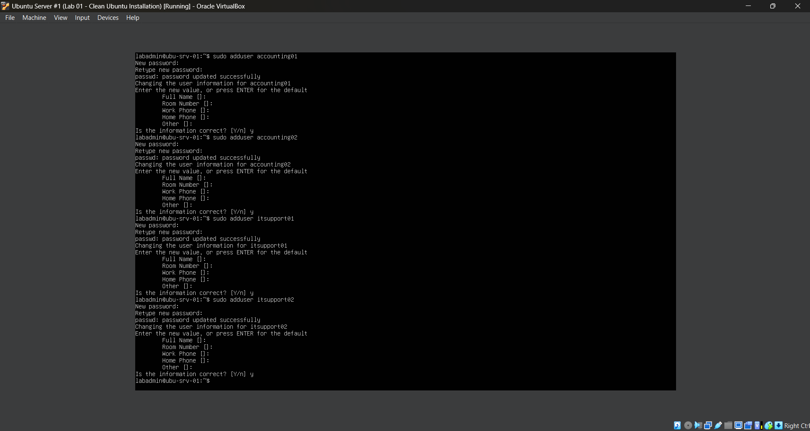
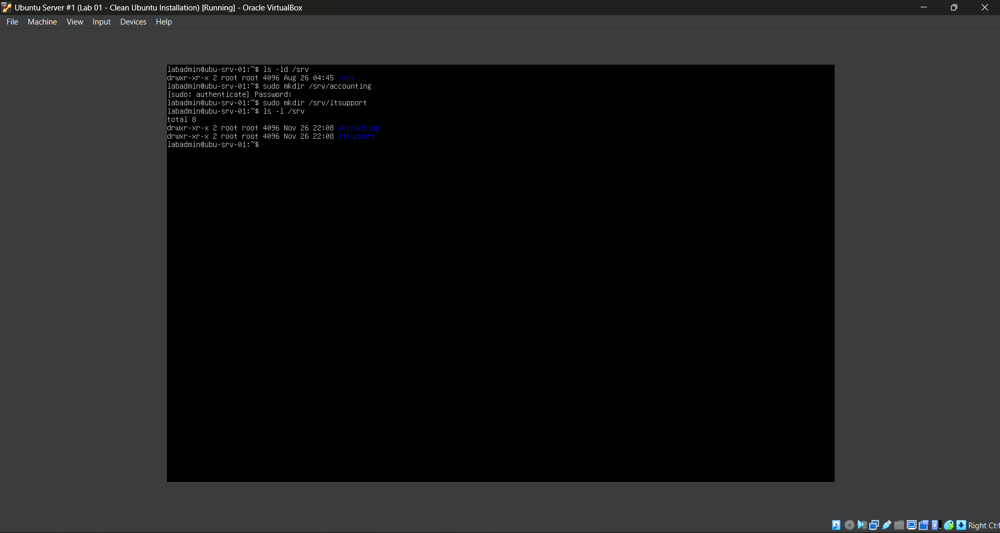
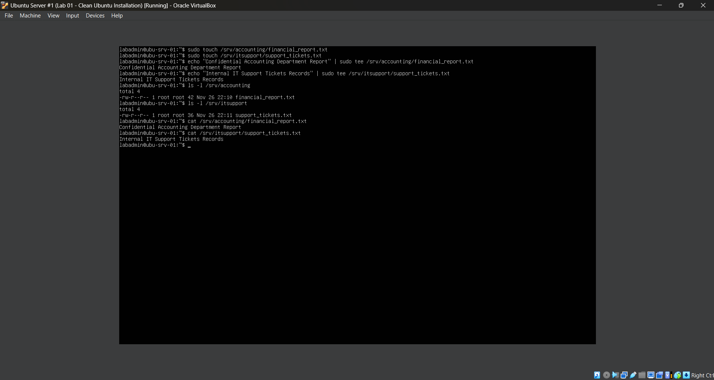

# Lab 4 - Linux File Permissions and Group-Based Access Control

## **Objective**

Learn how to configure and manage Linux file ownership, directory permissions, group-based access control, and advanced security permissions to protect shared resources in a simulated business environment.

## **Environment**

- Hypervisor / Virtualization: Oracle VirtualBox
- Server OS: Ubuntu Server 26.04.1 LTS
- Host OS: Windows
- Virtual Machine: Ubuntu Server #1
- Server Hostname: ubu-srv-01
- Administrator Account: labadmin
- Network Configuration: NAT (Network Address Translation)
- Remote Administration: OpenSSH Server

## **Skills Demonstrated**

## **Steps**


### *Step 1 - Create Department Groups and Employee Accounts*





I began by creating a simulated business environment consisting of two departments: Accounting and IT Support. Each department would have its own group and two employee accounts, which would later be used to configure and test group-based file permissions and access restrictions.

First, I ran the following commands to check whether the department groups already existed:

```bash
getent group accounting
getent group itsupport
```

- **`getent group accounting`** – Checks whether the `accounting` group exists and displays its group information if found.
- **`getent group itsupport`** – Checks whether the `itsupport` group exists and displays its group information if found.

The results showed that the `itsupport` group already existed from Lab 03 with a GID of `1002`. However, the `accounting` group did not exist.

I then ran the following commands to create and verify the Accounting group:

```bash
sudo groupadd accounting
getent group accounting
```

- **`groupadd`** – Creates a new group on the Linux system.
- **`getent group accounting`** – Verifies that the Accounting group was successfully created.

The results confirmed that the `accounting` group was successfully created with a GID of `1003`.

Next, I created four user accounts to represent employees working in both departments:

```bash
sudo adduser accounting01
sudo adduser accounting02
sudo adduser itsupport01
sudo adduser itsupport02
```

- **`adduser`** – Creates a new user account, configures its home directory, and prompts the administrator to set a password.

For each employee account, I configured a password and left the optional personal information fields blank. These accounts were created as standard users without sudo group membership so that I could accurately test access restrictions later in the lab.

After creating the employee accounts, I assigned each user to their respective department group using the following commands:

```bash
sudo usermod -aG accounting accounting01
sudo usermod -aG accounting accounting02
sudo usermod -aG itsupport itsupport01
sudo usermod -aG itsupport itsupport02
```

- **`usermod`** – Modifies an existing user account.
- **`-a`** – Appends the user to additional supplementary groups without removing their existing group memberships.
- **`-G`** – Specifies the supplementary group or groups that the user should belong to.

I then ran the following commands to verify each employee's group memberships:

```bash
groups accounting01
groups accounting02
groups itsupport01
groups itsupport02
```

- **`groups`** – Displays the primary and supplementary groups that a specified user belongs to.

The results confirmed that both Accounting employees belonged to the `accounting` group and both IT Support employees belonged to the `itsupport` group. Each employee also retained their existing primary group and membership in the `users` group.

Finally, I verified the members of both department groups using the following commands:

```bash
getent group accounting
getent group itsupport
```

The results confirmed the following department group memberships:

| Department Group | GID | Members |
| --- | --- | --- |
| accounting | 1003 | accounting01, accounting02 |
| itsupport | 1002 | itsupport01, itsupport02 |

This step established the foundation for implementing group-based access control. In professional IT environments, administrators commonly organize employees into groups based on their departments or job responsibilities. This simplifies permission management by allowing administrators to assign access to an entire group rather than configuring permissions for each individual user.

These department groups and employee accounts will be used throughout the remainder of the lab to configure shared directories, manage file ownership, and test authorized and unauthorized access.


### *Step 2 - Create Shared Departmental Directories*





After creating the department groups and employee accounts, I began establishing a directory structure where each department could store and share its files. These directories would later be used to configure file ownership, group-based permissions, and departmental access restrictions.

First, I ran the following command to examine the existing `/srv` directory:

```bash
ls -ld /srv
```

- **`/srv`** – A standard Linux directory intended for storing data provided by system services. In this lab, I used it as the location for departmental shared resources.
- **`-l`** – Displays detailed information, including permissions, ownership, group ownership, and modification dates.
- **`-d`** – Displays information about the directory itself rather than listing its contents.

The results showed that the `/srv` directory was owned by the `root` user and the `root` group.

Next, I created a separate directory for each department using the following commands:

```bash
sudo mkdir /srv/accounting
sudo mkdir /srv/itsupport
```

- **`sudo`** – Executes a command with elevated administrative privileges.
- **`mkdir`** – Creates a new directory.
- **`/srv/accounting`** – The shared directory intended for Accounting employees.
- **`/srv/itsupport`** – The shared directory intended for IT Support employees.

I used `sudo` because the `/srv` directory was owned by `root` and standard users did not have permission to create directories within it.

I then verified that both directories were successfully created using the following command:

```bash
ls -l /srv
```

The results confirmed that both departmental directories existed and were owned by the `root` user and the `root` group. Both directories had the following permissions:

```text
drwxr-xr-x
```

- **`d`** – Indicates that the resource is a directory.
- **`rwx`** – The owner has read, write, and execute permissions.
- **`r-x`** – Members of the owning group have read and execute permissions.
- **`r-x`** – All other users have read and execute permissions.

These permissions are represented numerically as `755`. At this stage, other users could list and navigate both departmental directories but could not create or remove files within them.

Next, I created a sample text file inside each departmental directory using the following commands:

```bash
sudo touch /srv/accounting/financial_report.txt
sudo touch /srv/itsupport/support_tickets.txt
```

- **`touch`** – Creates an empty file if the specified file does not already exist.
- **`financial_report.txt`** – Represents a sample confidential financial report belonging to the Accounting department.
- **`support_tickets.txt`** – Represents sample internal support ticket records belonging to the IT Support department.

After creating the files, I added sample content using the following commands:

```bash
echo "Confidential Accounting Department Report" | sudo tee /srv/accounting/financial_report.txt

echo "Internal IT Support Tickets Records" | sudo tee /srv/itsupport/support_tickets.txt
```

- **`echo`** – Outputs the specified text.
- **`|`** – Known as a pipe, which passes the output of one command as input to another command.
- **`tee`** – Reads input, writes it to a specified file, and displays the same content in the terminal.
- **`sudo tee`** – Executes the `tee` command with administrative privileges, allowing content to be written to files owned by `root`.

I used `sudo tee` because the sample files were owned by `root`, and my current account did not have direct write permissions to them without elevated privileges.

I then ran the following commands to verify the existence, ownership, and permissions of both files:

```bash
ls -l /srv/accounting
ls -l /srv/itsupport
```

The results confirmed that both files were successfully created and were owned by the `root` user and the `root` group. Both files had the following permissions:

```text
-rw-r--r--
```

- **`-`** – Indicates that the resource is a regular file.
- **`rw-`** – The owner has read and write permissions.
- **`r--`** – Members of the owning group have read-only permissions.
- **`r--`** – All other users have read-only permissions.

These permissions are represented numerically as `644`. Although the files represented confidential departmental resources, their current permissions allowed other users to read them. This demonstrated why default Linux permissions may not be sufficient when protecting sensitive departmental information.

Finally, I verified that the sample content was successfully written to both files using the following commands:

```bash
cat /srv/accounting/financial_report.txt
cat /srv/itsupport/support_tickets.txt
```

- **`cat`** – Displays the contents of a file directly in the terminal.

The results displayed the following content:

```text
Confidential Accounting Department Report
Internal IT Support Tickets Records
```

This confirmed that both departmental directories and their sample files were successfully created.

The final directory structure was organized as follows:

```text
/srv/
├── accounting/
│   └── financial_report.txt
└── itsupport/
    └── support_tickets.txt
```

In professional IT environments, departmental directories are commonly used to organize business resources and separate information based on employee responsibilities. However, creating separate directories alone does not prevent unauthorized access. Administrators must also configure appropriate ownership and permissions to protect sensitive information.

I intentionally left the default ownership and permissions unchanged during this step to establish a baseline before implementing group-based access control in the following steps.

## **Challenges**

## **What I Learned**

## **Next Steps**
